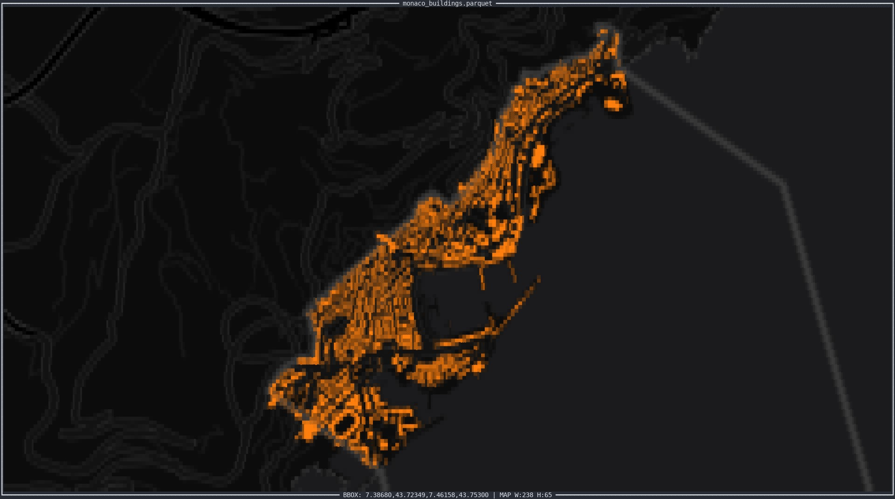
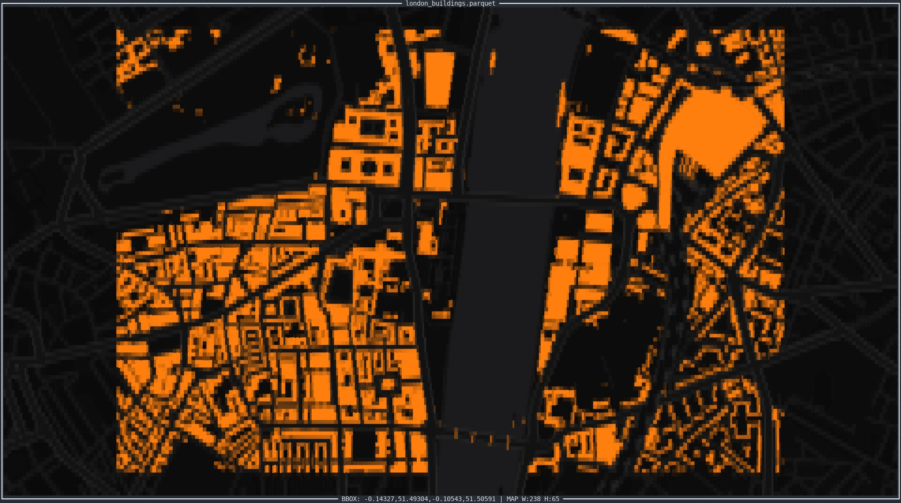
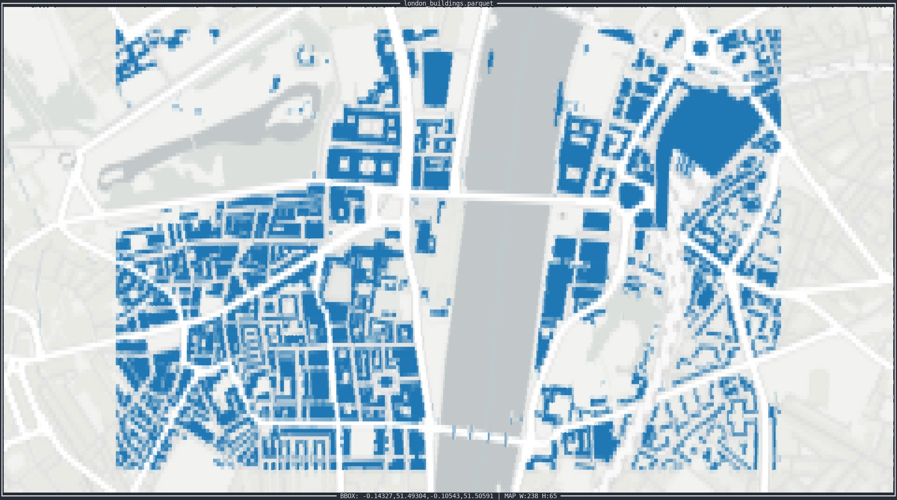
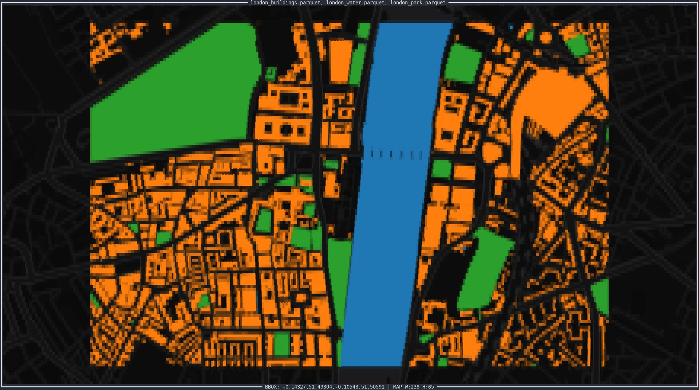
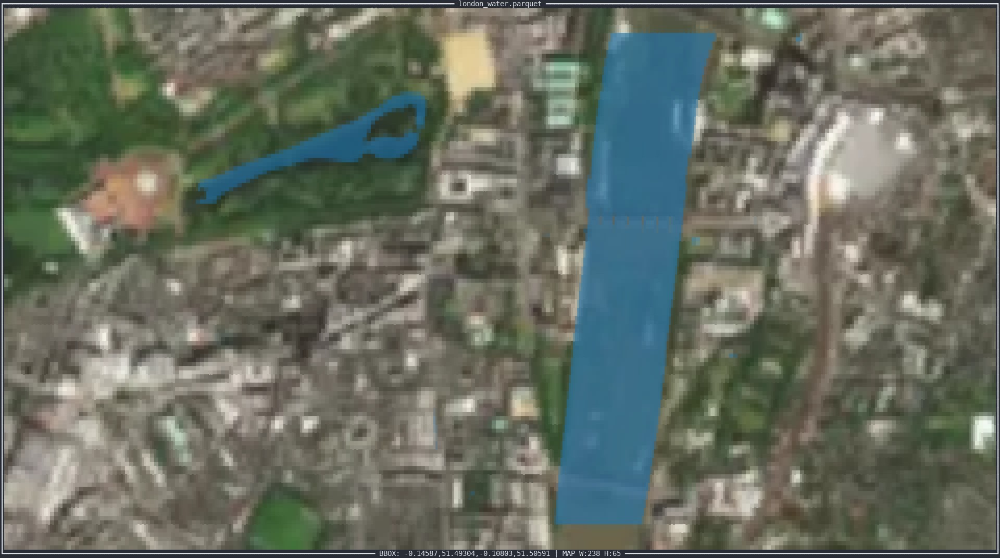
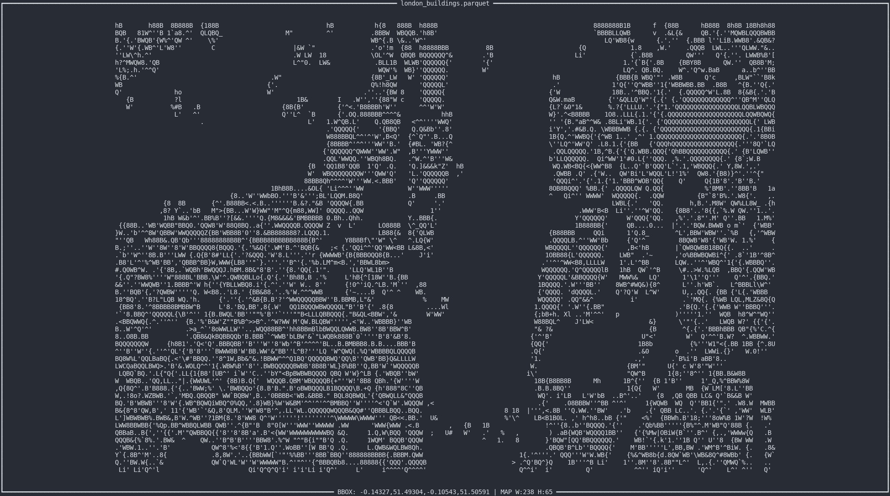
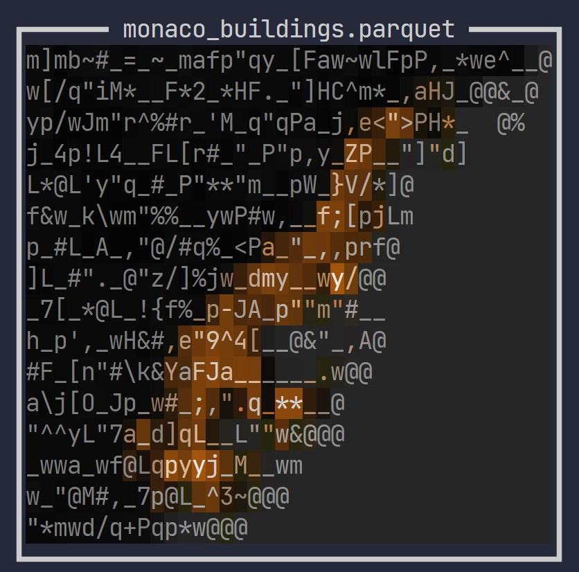
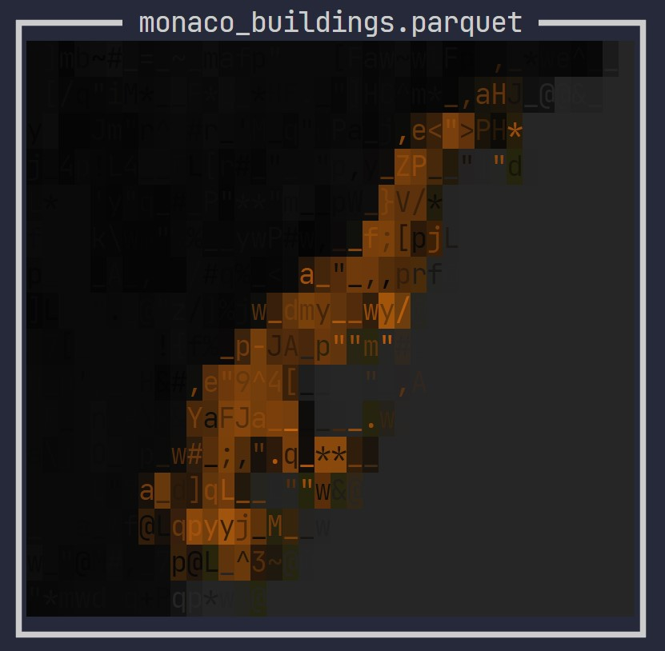

# pixel-map

Python CLI tool for plotting geo data in the terminal

<p align="center">
  <br/>
</p>

<p align="center">
    
    
    <a href="https://github.com/raczeq/pixel-map/actions/workflows/ci-prod.yml" target="_blank"></a>
    <a href="https://results.pre-commit.ci/latest/github/raczeq/pixel-map/main" target="_blank"></a>
    <a href="https://www.codefactor.io/repository/github/raczeq/pixel-map"></a>
    <a href="https://app.codecov.io/gh/raczeq/pixel-map/tree/main"></a>
    <a href="https://pypi.org/project/pixel-map" target="_blank"></a>
    <a href="https://pypi.org/project/pixel-map" target="_blank"></a>
    <a href="https://pypi.org/project/pixel-map" target="_blank"></a>
</p>

[Documentation](https://raczeq.github.io/pixel-map/) · [Examples](https://raczeq.github.io/pixel-map/examples/) · [Basemaps](https://raczeq.github.io/pixel-map/basemaps/) · [Renderers](https://raczeq.github.io/pixel-map/renderers/)

## Installation

PyPI:

```sh
$ pip install pixel-map
```

uv:

```sh
$ uv pip install pixel-map
```

## Usage

To display your data in the terminal, you can just pass a filename as an argument:
```sh
$ pixel-map <file_name>
```

Tool can also display data for multiple files at once:
```sh
$ pixel-map <file_name_1> <file_name_2>
```

See more examples below ⬇️

<details>
  <summary>CLI Help output (<code>pixel-map -h</code>)</summary>

```console
 Usage: pixel-map [OPTIONS] {files}...

 Plot the geo data into a terminal.

 Generates a Matplotlib canvas that is rendered to an image and later transformed into a list of
 unicode characters.

╭─ Arguments ──────────────────────────────────────────────────────────────────────────────────────────────────────────────────────────────────────────────────────────────────────╮
│ *    files      <str>  List of files to display. Those could be any that can be opened by GeoPandas. [required]                                                                  │
╰──────────────────────────────────────────────────────────────────────────────────────────────────────────────────────────────────────────────────────────────────────────────────╯
╭─ Options ────────────────────────────────────────────────────────────────────────────────────────────────────────────────────────────────────────────────────────────────────────╮
│ --bbox                         -b             BBOX   Clip the map to a given bounding box. Expects 4 floating point numbers separated by commas.                                 │
│ --renderer                     -r             <str>  Renderer used for generating terminal output. Possible values: all, ascii, ascii-bw, block, braille, braille-bw, half,      │
│                                                      quad, space.                                                                                                                │
│                                                      [default: (block)]                                                                                                          │
│ --dark                             --light           Uses the predefined dark or light style. Can be overriden with user defined style. [default: dark]                          │
│ --color                        -c             COLOR  Pass color or list of colours per each geo file.                                                                            │
│ --alpha,--opacity              -a             FLOAT  Pass opacity or list of opacities per each geo file.                                                                        │
│ --basemap,--tileset            -t             TILES  Set the basemap. Can be a name of a basemaplibre style, or a URL or a path of a MapLibre style JSON. Raster tiles (like     │
│                                                      names of xyzservices) need contextily to be installed. Defaults to OpenFreeMap.Dark if --dark or OpenFreeMap.Positron if    │
│                                                      --light.                                                                                                                    │
│ --no-border,--fullscreen       -f                    Removes the border around the map.                                                                                          │
│ --no-background,--no-bg                              Removes the background of the map and plots only geo data.                                                                  │
│ --background-color,--bg-color                 COLOR  Set the background color. Can be used together with --no-background.                                                        │
│ --width                                       INT    Override the current console width.                                                                                         │
│ --height                                      INT    Override the current console height.                                                                                        │
│ --dpi                                         INT    DPI used to rasterise the matplotlib plot. Setting this to 8 (matching the renderer's subpixel width) skips the PIL resize  │
│                                                      for a faster path; higher values improve anti-aliasing quality.                                                             │
│                                                      [default: 8]                                                                                                                │
│ --example,--example-files                            Can be used to load one of example files based on name. Possible values: london_buildings, london_park, london_water,       │
│                                                      monaco_buildings.                                                                                                           │
│ --version                      -v                    Show the application's version and exit.                                                                                    │
│ --install-completion                                 Install completion for the current shell.                                                                                   │
│ --show-completion                                    Show completion for the current shell, to copy it or customize the installation.                                            │
│ --help                         -h                    Show this message and exit.                                                                                                 │
╰──────────────────────────────────────────────────────────────────────────────────────────────────────────────────────────────────────────────────────────────────────────────────╯
```
</details>

## Examples

`pixel-map` is published with few example files for testing.

#### Basic usage

```sh
$ pixel-map --example london_buildings
```
<p align="center">
  <br/>
</p>

#### Light mode

```sh
$ pixel-map --example london_buildings --light
```
<p align="center">
  <br/>
</p>

#### Multiple files with different colors

```sh
$ pixel-map --example london_buildings london_water london_park -c C1,C0,C2
```
<p align="center">
  <br/>
</p>

#### Different basemap and changed opacity (alpha)

```sh
$ pixel-map --example london_water -c C0 -a 0.6 -t VersaTiles.Satellite
```
<p align="center">
  <br/>
</p>

#### No background and different renderer

You can explore [multiple available renderers](https://raczeq.github.io/pixel-map/renderers/).

```sh
$ pixel-map --example london_buildings --no-bg -r ascii-bw
```
<p align="center">
  <br/>
</p>

## Dependencies

- `typer[all] (>=0.9.0)` (click, colorama, rich, shellingham): Required for CLI

- `rich (>=12.0.0)`: For showing progress and generating terminal output

- `geopandas (>=0.8)`: For reading Geo files and plotting

- `pyarrow (>=16.0.0)`: For geoparquet files support

- `matplotlib (>=3.2.0)`: For generating the plot with styling and cropping

- `basemaplibre (>=0.1.1)`: For adding basemap to the plot (raster tiles need `contextily`, which is not installed by default)

- `numpy (>=1.26.0)`: For transforming matplotlib array into an image

- `pillow (>=10.1.0)`: For rasterising ASCII glyph templates and downscaling the canvas

## How does it work?

1. Files are read by `GeoPandas` to GeoSerieses.
2. `Matplotlib` figure is created with the size of the terminal (`pixel-map` expects a default monospace font with the ratio of 8 to 16 pixels. Figure canvas takes terminal height and multiplies it by two).
3. GeoSerieses are plotted to the canvas.
4. Plot bounding box is expanded to the canvas ratio (based on terminal size).
5. Basemap is drawn with `basemaplibre` from a MapLibre style, without labels.
6. Canvas is copied to the image as an `NumPy` array.
7. Image is downsampled and converted to a grid of Unicode characters with
   foreground/background colours using the native dual-colour engine in
   `pixel_map/terminal_renderers.py` (Lab perceptual distance, BLAS-accelerated
   character selection).
8. `Rich` string output is generated using the list of unicode characters with background and foreground colors.
9. Output is printed to the console.

## FAQ

- **Why does my terminal render visible characters in the output?**

  Check if your terminal doesn't have automatic contrast changer for WCAG compatibility.

  For example in VS Code there is an option `terminal.integrated.minimumContrastRatio` that is set to `4.5` by default.

  | Contrast: 4.5 | Contrast: 1 |
  | --- | --- |
  |  |  |

- **Why are there black bars on the left/right, top/bottom of the output?**

  This can happen when output is bigger than Earth bounding box and basemap doesn't cover that far, but image is stretched to the full terminal size.

## Contributing

If you want to contribute, please fork the repository, use `pdm` tool to install the project.

To run the tests you can use command `tox -e python3.12` (or other python version, `-e` is for the environment) or with simple `pytest tests`.

Please remember to update `CHANGELOG.md` with description your changes.
